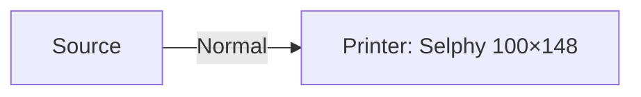
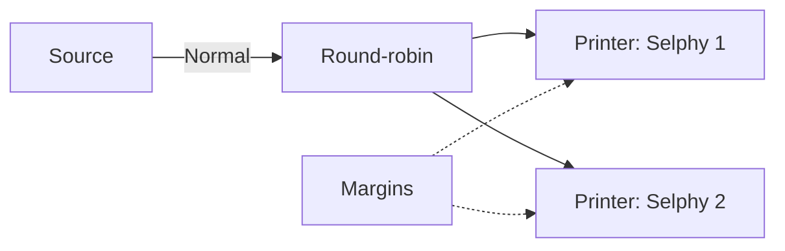
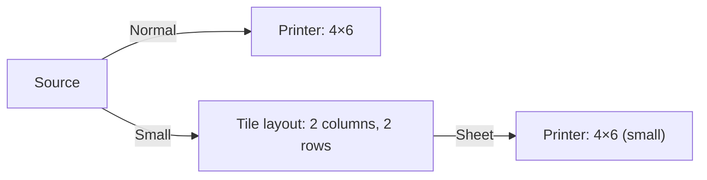
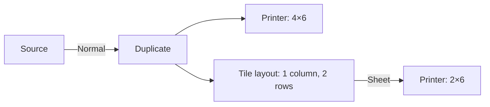
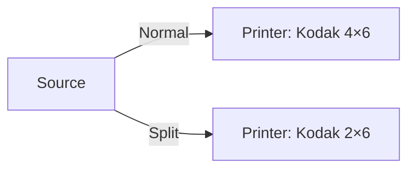

# Printer

Printing your photos and having a physical reminder of an awesome event is one of the most fun parts of having a photo booth. Therefore MomentoBooth has well-configurable printer support! Which printer prints which print size, on what media and in which layout is set up on the [Print routing](settings_print_routing.md) settings page. This page walks you through setting it up, with some common set-ups as examples. For collage dimensions, also see the [template settings](settings_templating.md).

Getting the print settings right requires quite a bit of trial and error. Ideally a print shows the full collage without parts being cut-off or white borders. For this purpose you probably want to use borderless printing.

## Print systems

MomentoBooth supports two ways of printing, and you can combine them in one set-up:

- **Native** printing uses the [printing package](https://pub.dev/packages/printing) to print to the printers installed on your computer, like any other application does. This is the easiest way to get started.
- **CUPS** printing sends the prints to a queue on a CUPS server, which can run on the same computer or elsewhere on the network. The server is configured in the [hardware settings](settings_hardware.md#cups-server). With CUPS, MomentoBooth can list the media sizes each queue supports, so you do not have to enter the paper size yourself. On Windows, native printers list the papers of their driver too.

## Basic set-up

1. Install the printer on your computer (native), or add it as a queue to your CUPS server (CUPS), and print a test page from there to be sure it works.
1. Open the settings with the menubar or `Ctrl+S` and go to the **Print routing** page. A new installation already has the _Normal_ output of the source connected to a single printer node. If the printer was connected after opening the page, click **Refresh printers** in the side panel.
1. Configure the printer node:
   1. Give it a **Label**, e.g. the name of the printer and the paper, so you can recognise it in the routes overview.
   1. Choose the **Backend**: _Native_ or _CUPS_.
   1. Select the **Printer** (native) or **Queue** (CUPS).
   1. For a CUPS printer, select the **Media**; the size follows from it. For a native printer on Windows, select the **Paper** in the same way. For a native printer on macOS or Linux, enter the **Size** of the paper in mm.
   1. Leave the **Margins** at 0 for now.
1. Check the **Routes** in the side panel: _Normal_ should list your printer, and the **Problems** list should be empty.
1. Make sure the project setting [Enable printing](settings_project.md#enable-printing) is on.
1. Take a photo and print it. Tune the margins of the printer node until the print shows the full collage without white borders: increase a margin when the printer cuts off part of the photo on that side, decrease it when a white border remains. The last printed sheet is also saved as `latest-print.pdf` in the output folder of the project.

Print sizes that are not routed to a printer are not offered in the print dialog. So with the basic set-up, users can only choose the normal print size.

## Example set-ups

The examples below show only the relevant part of the routing. Arrows are connections; each printer node is a printer configuration with its own printer or queue and media size.

### One printer for normal prints

The basic set-up: every normal print goes to one printer, so the Normal output of the source connects straight to the printer node.

### Two printers sharing the work

When one printer cannot keep up, put a round-robin node between the source and the printers. Copies are distributed over the printers in turn: when a user prints four copies, each printer prints two of them.

When both printers are of the same type, connect a margins node to the margins input of both printers, so you only have to tune the margins once. If one of the printers is not configured yet, it is skipped and the other one prints everything.

### Small prints, tiled 2×2

Small and tiny prints put several copies of a photo on one sheet, e.g. to hand out to a group. Route the _Small_ output through a tile layout node with 2 columns and 2 rows to a printer, and every sheet holds four copies of the photo. The print dialog shows how many copies a sheet contains.

A printer node accepts photos as well as tiled sheets, so the tile layout could also be connected to the first printer node. A separate printer node, using the same printer or queue, is needed when the tiled prints use different media or margins. The photos are turned to match the orientation of the tiles automatically; switch on _Rotate_ on the tile layout to turn them the other way.

### A normal print plus a tiled copy

A duplicate node sends every copy to all its outputs. This way a user gets a normal print and a sheet with small copies to share, from one press of the print button.

### Split prints for three-photo collages

A collage of three photos holds the photos twice, side by side, so it can be printed as two strips. When the _Split_ output is routed, a three-photo collage printed at normal size follows the _Split_ route: the left and right halves are printed as two separate pages, e.g. on 2×6" media. When _Split_ is not routed, the collage follows the _Normal_ route and is printed as a whole, to be cut apart afterwards.

Split prints are always printed in halves, so tile layouts on their route are not used.

## Recommended settings for Canon Selphy CP1300/CP1500

The Canon Selphy series of cheap and compact photo printers. The Selphy printers are quite convenient for photo booth purposes, as long as the volume of prints is not too big, since they have a limited and ink roll paper storage volume.

Here are settings that are known to be approximately right for using this type of printer, with a native printer node.

| Property | Value |
|---|---|
| [Collage aspect ratio](settings_templating.md#collage-aspect-ratio) | 1.48 |
| [Collage padding](settings_templating.md#collage-padding) | 10 |
| Printer node: Backend | Native |
| Printer node: Size (mm) | W 100 × H 148 |
| Printer node: Margins | Top 0.0, Right 1.6, Bottom 0.5, Left 1.6 |
| [Use printer settings for native printers](settings_hardware.md#use-printer-settings-for-native-printers) | On |

Make sure to set the default settings of the printer to **portrait mode**, **borderless**, and the right paper-size.

## Recommended settings for Kodak 6850

Another photo printer that has been used is the Kodak 6850. This printer can handle a lot larger volume with its higher paper/ink capacity and speed.

The Kodak has been tested with CUPS printer nodes, where the following settings work well.

| Property | Value |
|---|---|
| [Collage aspect ratio](settings_templating.md#collage-aspect-ratio) | 1.49 |
| [Collage padding](settings_templating.md#collage-padding) | 10 |
| Printer node: Backend | CUPS |
| Printer node: Media | 4×6 |
| Printer node: Margins | Top 0.0, Right 0.0, Bottom 1.5, Left 0.0 |

For the other print sizes, add a printer node per media size, all with the Kodak's queue:

- **Small:** a tile layout with 1 column and 2 rows, to a printer node with 4×6 media.
- **Tiny:** a tile layout with 1 column and 2 rows, to a printer node with 2×6 media.
- **Split:** directly to a printer node with 2×6 media.
