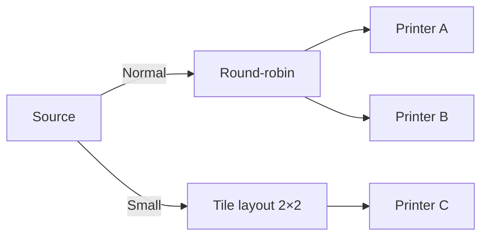

# Print routing settings

The print routing page decides which printer prints which print size, on what media, with which margins and in which layout. It does so with a small node editor: you place nodes on a canvas and connect them, and every print follows those connections from the print size the user chose to one or more printers. For a step-by-step guide with common set-ups, see the [printer setup page](printer_setup.md).

Like the hardware settings, print routing is an app setting: it is saved with the app's settings rather than in the project folder. Every change is saved automatically, about half a second after your last edit.

## How print routing works

When a user prints a photo, they choose a print size in the print dialog: _Normal_, _Small_ or _Tiny_. The print starts at the output of that print size on the **source** node and follows the connections to the **printer** nodes it ends up at. On the way it can be distributed over several printers, duplicated, or laid out in a grid.

A few rules follow from this:

- A print size that is not routed to a usable printer disappears from the print dialog.
- The print button is only shown when the project setting [Enable printing](settings_project.md#enable-printing) is on and the photo can be printed at one of the routed print sizes.
- The _Split_ print size is not a choice in the print dialog. When a user prints a collage of three photos at _Normal_ size and _Split_ is routed, the print follows the _Split_ route instead. When _Split_ is not routed, the _Normal_ route is used. A booth that only offers split prints can route _Split_ alone: collages of three photos then offer _Normal_, which prints split, and other photos cannot be printed.
- Every copy is routed separately. When a user prints three copies, each copy follows its own route, so a round-robin node can send them to different printers.
- Branches that do not lead to a usable printer for the print size are skipped, so a print never ends up nowhere as long as one route works. When a printer fails while printing, a round-robin node lets its next output print the copy, and a duplicate node still prints on its other outputs. The print only fails when no printer takes a copy.

A new installation starts with a source whose _Normal_ output is connected to a single printer node. That printer still has to be configured before anything can be printed.

## The page

The page consists of four parts:

- The **toolbar** at the top with _Undo_, _Redo_ and _Fit view_ (which zooms the canvas to show all nodes), followed by a button per node type that adds that node in the middle of the view.
- The **canvas** with the nodes and their connections.
- The **side panel** on the right, which lists the routes, the problems and the printer refresh button, see [routes, problems and printers](#routes-problems-and-printers).
- The **status line** at the bottom, which shows a short reminder of the mouse controls, or explains why a connection you are drawing is refused.

## Node types

Each node has a coloured header with its name, ports on the left (inputs) and right (outputs), and, depending on the type, some fields. Problems with a node are shown as notes at the bottom of that node.

### Source

The source node is where every print starts. It has an output per print size: **Normal**, **Split**, **Small** and **Tiny**. There is always exactly one source node: it cannot be deleted, copied or duplicated.

Each output takes a single connection. To send a print size to more than one place, connect it to a round-robin or duplicate node. Print sizes that are not routed to any printer are listed in a note on the source node, e.g. _Not routed: Split, Tiny_. This is information rather than a problem, as not every booth uses every print size.

### Round-robin

A round-robin node distributes copies over all its connected outputs in turn: the first copy goes to the first output, the next copy to the second output, and so on. Use it to spread the load over several printers, for example two printers that each print half of the copies.

The node remembers whose turn it is until the print routing is changed or the app is restarted. Outputs that do not lead to a usable printer for the print size at hand are skipped. When the printer whose turn it is fails, the next output prints the copy, and the next copy starts after that output.

### Duplicate

A duplicate node sends every copy to all its connected outputs, also when one of their printers fails. Use it to print one photo in several ways at once, for example as a normal print on one printer and as a tiled sheet of small photos on another. The number of copies shown in the print dialog takes this into account.

Round-robin and duplicate nodes have an **In** port, which takes a single connection, and an **Out** port, which accepts any number of connections. So such a node handles a single print size; print sizes only come together at a printer. To let two print sizes share the same printers, use a round-robin node for each print size and connect both to the printers. They carry either photos or sheets (see [ports and connections](#ports-and-connections)), whichever is connected to them. A caption on the node shows what it carries: _Carries photos_, _Carries sheets_ or _Carries nothing yet_.

### Tile layout

A tile layout node places a photo several times on one sheet, in a grid. It takes a **Photo** and turns it into a **Sheet**, both with a single connection. Its fields are:

| Field | Meaning |
|---|---|
| Columns | The number of columns of the grid, at least 1. |
| Rows | The number of rows of the grid, at least 1. |
| Rotate | Turns every photo a quarter turn compared to how it would be placed by default. |

The grid is laid out on the media and within the margins of the printer the sheet ends up at, so the same tile layout can feed printers with different media. Every tile has the same size, and the photo is fitted in each tile. By default the photo is turned to match the orientation of the tile: a landscape photo in a portrait tile is turned a quarter turn. _Rotate_ inverts that choice.

Split prints are always printed in halves, so a tile layout on the route of the _Split_ print size is not used for them. The editor shows a warning when that happens.

### Margins

A margins node holds a set of margins (top, right, bottom and left, in mm) that can be shared between printer nodes. Its **Margins** output can be connected to the margins input of any number of printers, so you only have to tune the margins of, say, three identical printers once.

### Printer

A printer node is one printer configuration: one printer or CUPS queue with one media size. To print on different media with the same printer, for example 4×6" for small prints and 2×6" for tiny prints, add a printer node for each media size with the same printer or queue, and give them a label to tell them apart.

| Field | Meaning |
|---|---|
| Label | A name for this configuration, shown in the node header, the routes overview and the problems list. |
| Backend | _Native_ prints through the operating system's printers. _CUPS_ prints to a queue on the CUPS server configured in the [hardware settings](settings_hardware.md#cups-server). Changing the backend clears the printer and media, as they mean nothing to the other backend. |
| Printer / Queue | The printer (native) or CUPS queue to print to. The options are listed when the page opens, see [Refresh printers](#routes-problems-and-printers). A saved printer that is not available at the moment is shown with _(not found)_. |
| Media / Paper | The media to print on. For a CUPS printer (_Media_), chosen from the media the selected queue supports. For a native printer on Windows (_Paper_), chosen from the papers the printer driver supports, e.g. _4x6 (borderless)_; prints then use exactly that paper and keep the other settings of the driver, such as borderless printing. Papers that share a size, such as with and without border, are told apart. Changing the queue or printer clears the media, as media differ per printer. On macOS and Linux native printers have no _Paper_ field. |
| Size (mm) | The width and height of the media. For CUPS printers and native printers on Windows they follow from the selected media. For native printers on macOS and Linux you enter these yourself; set them to the paper size you print on. |
| Margins | The margins (top, right, bottom and left, in mm) for this printer, see [margins](#how-prints-are-laid-out). These fields are hidden when a margins node is connected to the margins input; the caption then reads _from the connected node_. |

A printer node has two inputs. The **Job** input accepts photos as well as sheets and takes any number of connections. A photo that is connected directly, without a tile layout, is fitted on the sheet as a whole. The **Margins** input sits next to the margins fields and takes a single margins node.

A printer node only prints once it is complete: a native printer needs a printer and a media width and height; a CUPS printer needs a queue and media. A native printer on Windows whose size was set by hand, e.g. on another computer, still prints as before, without choosing a paper; select a _Paper_ to print on that exact paper. A printer that receives prints while it is incomplete gets a warning and is skipped. So is a printer whose margins leave no room on its media. Unconnected printer nodes are fine, so you can keep configurations around for later use.

## Ports and connections

The ports are coloured by what they carry:

| Colour | Type | Meaning |
|---|---|---|
| Blue | Photo | A photo at the print size the user chose. Comes from the source. |
| Orange | Sheet | A photo laid out on a sheet. Comes from a tile layout. |
| Green | Margins | A set of margins. Comes from a margins node. |

The ports of round-robin and duplicate nodes take the colour of what they carry, and are grey while nothing is connected to them yet. The job input of a printer takes the colour of what is connected to it. Connections take the colour of the port they start at.

To connect two nodes, drag from a port to a port of another node. Only matching ports can be connected: the editor refuses a connection that carries the wrong type or that would create a loop, and the status line at the bottom explains why when the colours do not already tell. A round-robin or duplicate node carries a single type, so it cannot mix photos and sheets.

Some ports take a single connection: the outputs of the source, the inputs of round-robin and duplicate nodes, both ports of a tile layout and the margins input of a printer. Connecting a new connection to such a port replaces the old one.

## Routes, problems and printers

The side panel to the right of the canvas has three sections:

- **Routes** lists, per print size, the printers it can end up at by their label (or _Unnamed printer_), or _Not printed_ when the print size is not routed.
- **Problems** lists the errors and warnings of all nodes. Click a problem to select and centre its node on the canvas. The same problems are shown as notes on the nodes themselves: red for errors, yellow for warnings.
- **Printers** has the **Refresh printers** button. The printers, CUPS queues, media and papers to choose from are listed when the page opens. Refresh them after connecting a printer, starting the CUPS server or changing the CUPS server settings.

Connections with errors are ignored, while the rest of the routing keeps working. When the routing has problems, when no print size reaches a configured printer, or when a printer failed during the last print, the printing subsystem shows a warning on the [subsystem status](settings_subsystem.md) page. The subsystem is only disabled when the project setting [Enable printing](settings_project.md#enable-printing) is off.

| Message | Meaning |
|---|---|
| Select a printer and set the media size to print with it. | A native printer receives prints, but has no printer or media size set. It is skipped. |
| Select a queue and media to print with this printer. | A CUPS printer receives prints, but has no queue or media set. It is skipped. |
| The margins leave no room to print on the media. | The left and right margins together, or the top and bottom margins together, are as large as the media or larger. The printer is skipped. |
| Split prints are always printed in halves, so this layout is not used for them. | A tile layout is on the route of the _Split_ print size. It is still used for the other print sizes. |
| Normal prints are not routed, so only collages of three photos can be printed. | Information on the source: _Split_ is routed, but _Normal_ is not. Photos that are not a collage of three photos cannot be printed. |
| Not routed: … | Information on the source: these print sizes are not routed to any printer and are not offered in the print dialog. |
| This input accepts a single connection. | More than one connection ends at a port that takes a single connection. |
| The connection from … carries the wrong type. | A connection carries photos where sheets are expected, or the other way around. |
| Connections form a loop. | The connections lead back to a node they came from. |
| Only one source is used, this one is ignored. | There is more than one source node. Only the first one routes prints. |
| There is no source node. | The routing has no source, so nothing can be printed. |
| Columns and rows must be at least 1. | A tile layout has an invalid grid. Its connections are ignored. |
| A stored connection is invalid and is ignored. / A connection is stored twice. / Two nodes share the ID "…". | The saved routing is damaged, for example after editing the settings file by hand or importing settings. |

## Editing

The mouse controls are:

| Action | Effect |
|---|---|
| Drag a node | Move the node. |
| Drag from a port | Draw a connection. |
| Right-click the canvas | Add a node at that spot. |
| Right-click a node | Delete the node. |
| Right-click a connection | Delete the connection. |
| Right-click a port | Disconnect all connections of that port. |
| Mouse wheel | Zoom. |
| Middle mouse button, or Space and drag | Pan the canvas. |

The keyboard shortcuts are:

| Shortcut | Effect |
|---|---|
| `Delete`, `Backspace` | Delete the selected nodes. |
| `Esc` | Clear the selection. |
| `Ctrl+A` | Select all nodes. |
| `Ctrl+Z` | Undo. |
| `Ctrl+Y`, `Ctrl+Shift+Z` | Redo. |
| `Ctrl+C`, `Ctrl+X`, `Ctrl+V` | Copy, cut and paste the selected nodes. |
| `Ctrl+D` | Duplicate the selected nodes. |
| Arrow keys | Move the selected nodes by one grid step. |
| `Shift` + arrow keys | Move the selected nodes by one pixel. |

The shortcuts do not apply while you are typing in a field of a node. The source node is left out when deleting, copying, cutting or duplicating a selection.

## How prints are laid out

The printable area of a sheet is the media size of the printer minus its margins. The margins describe the part of the media that ends up visible on the print: increase a margin when the printer cuts off part of the photo on that side, and decrease it when a white border remains.

- **Without a tile layout**, the photo is fitted in the printable area as a whole, centred and without cropping. It is turned a quarter turn when its orientation does not match that of the area, so a landscape collage on portrait media is printed sideways to use the paper well.
- **With a tile layout**, the printable area is divided into equal tiles, and the photo is fitted in each tile, turned to match the orientation of the tile (or the other way when _Rotate_ is on).
- **Split prints** are printed as two pages: the left half of the collage on the first page and the right half on the second. Each half fills the height of the printable area. The margins between the halves (the right margin of the first page and the left margin of the second) are left out, so the halves line up when put together. Tile layouts are not used for split prints.

The last printed sheet is saved as `latest-print.pdf` in the output folder of the project, which is handy to check the layout without wasting paper. For more detail, turn on _Enable extensive print job logging_ in the [debug settings](settings_debug.md), which keeps the PDFs and details of every print job in a `PrintJobs` folder inside the output folder. To test the routing without printing at all, turn on _Skip sending print jobs to printers_ in the same settings: prints are routed and rendered as usual, but not sent to a printer, and not counted in the statistics.
