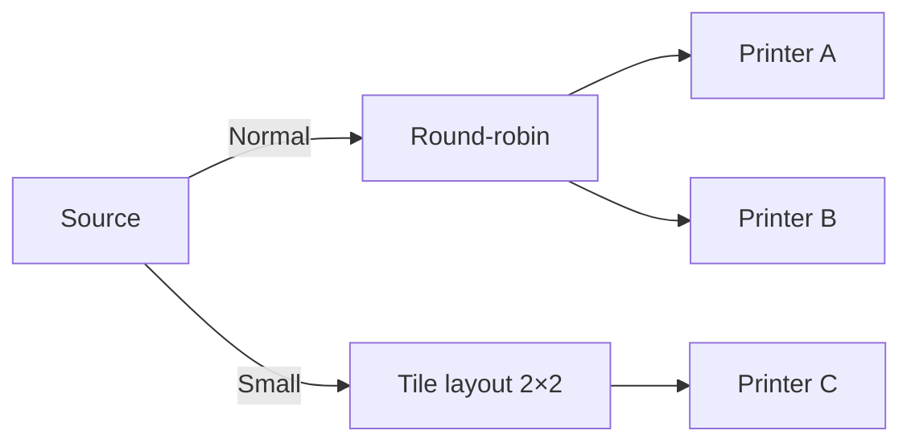
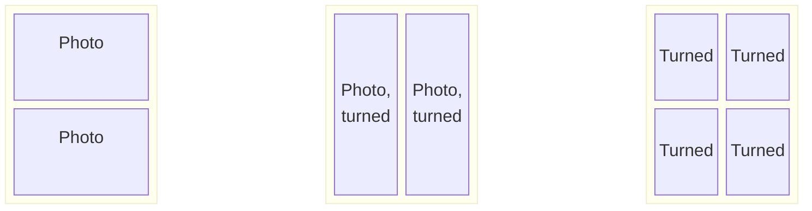
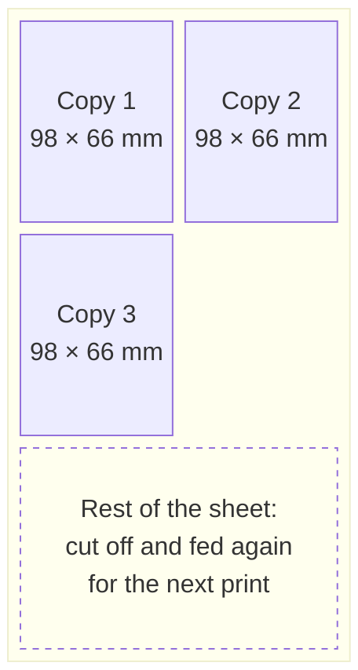

# Print routing settings

The print routing page decides which printer prints which print size, on what media, with which margins and in which layout. It does so with a small node editor: you place nodes on a canvas and connect them, and every print follows those connections from the print size the user chose to one or more printers. For a step-by-step guide with common set-ups, see the [printer setup page](printer_setup.md).

Like the hardware settings, print routing is an app setting: it is saved with the app's settings rather than in the project folder. Every change is saved automatically, about half a second after your last edit.

## How print routing works

When a user prints a photo, they choose a print size in the print dialog: _Normal_, _Small_ or _Tiny_. The print starts at the output of that print size on the **source** node and follows the connections to the **printer** nodes it ends up at. On the way it can be distributed over several printers, duplicated, laid out in a grid, or stacked with its other copies on a sheet.

A few rules follow from this:

- A print size that is not routed to a usable printer disappears from the print dialog.
- The print button is only shown when the project setting [Enable printing](settings_project.md#enable-printing) is on and the photo can be printed at one of the routed print sizes.
- The _Split_ print size is not a choice in the print dialog. When a user prints a collage of three photos at _Normal_ size and _Split_ is routed, the print follows the _Split_ route instead. When _Split_ is not routed, the _Normal_ route is used. A booth that only offers split prints can route _Split_ alone: collages of three photos then offer _Normal_, which prints split, and other photos cannot be printed.
- Every copy is routed separately. When a user prints three copies, each copy follows its own route, so a round-robin node can send them to different printers. Copies that end up at the same [stack](#stack) share its sheets.
- Branches that do not lead to a usable printer for the print size are skipped, so a print never ends up nowhere as long as one route works. When a printer fails while printing, a round-robin node lets its next output print the copy, and a duplicate node still prints on its other outputs. The print only fails when no printer takes a copy, or when the printer of a [stack](#stack) fails (when the stack collects copies, they keep waiting instead).

A new installation starts with a source whose _Normal_ output is connected to a single printer node. That printer still has to be configured before anything can be printed.

## The page

The page consists of four parts:

- The **toolbar** at the top with _Undo_, _Redo_ and _Fit view_ (which zooms the canvas to show all nodes), followed by a button per node type that adds that node in the middle of the view.
- The **canvas** with the nodes and their connections.
- The **side panel** on the right, which lists the routes, the problems and the printer refresh button, see [routes, problems and printers](#routes-problems-and-printers).
- The **status line** at the bottom, which shows a short reminder of the mouse controls, or explains why a connection you are drawing is refused.

## Node types

Each node has a coloured header with its name, ports on the left (inputs) and right (outputs), and, depending on the type, some fields. Problems with a node are shown as notes at the bottom of that node.

### Source

The source node is where every print starts. It has an output per print size: **Normal**, **Split**, **Small** and **Tiny**. There is always exactly one source node: it cannot be deleted, copied or duplicated.

Each output takes a single connection. To send a print size to more than one place, connect it to a round-robin or duplicate node. Print sizes that are not routed to any printer are listed in a note on the source node, e.g. _Not routed: Split, Tiny_. This is information rather than a problem, as not every booth uses every print size.

### Round-robin

A round-robin node distributes copies over all its connected outputs in turn: the first copy goes to the first output, the next copy to the second output, and so on. Use it to spread the load over several printers, for example two printers that each print half of the copies.

The node remembers whose turn it is until the print routing is changed or the app is restarted. Outputs that do not lead to a usable printer for the print size at hand are skipped. When the printer whose turn it is fails, the next output prints the copy, and the next copy starts after that output.

### Duplicate

A duplicate node sends every copy to all its connected outputs, also when one of their printers fails. Use it to print one photo in several ways at once, for example as a normal print on one printer and as a tiled sheet of small photos on another. The number of copies shown in the print dialog takes this into account.

Round-robin and duplicate nodes have an **In** port, which takes a single connection, and an **Out** port, which accepts any number of connections. So such a node handles a single print size; print sizes only come together at a printer or a stack. To let two print sizes share the same printers, use a round-robin node for each print size and connect both to the printers. They carry either photos or sheets (see [ports and connections](#ports-and-connections)), whichever is connected to them. A caption on the node shows what it carries: _Carries photos_, _Carries sheets_ or _Carries nothing yet_.

### Tile layout

A tile layout node places a photo several times on one sheet, in a grid. It takes a **Photo** and turns it into a **Sheet**, both with a single connection. Its fields are:

| Field | Meaning |
|---|---|
| Columns | The number of columns of the grid, at least 1. |
| Rows | The number of rows of the grid, at least 1. |

A tile layout has no size of its own. The grid is laid out on the media of the printer the sheet ends up at, within the margins of that printer: the printable area is divided into _columns_ × _rows_ tiles of equal size. The photo is fitted in each tile as a whole, centred and without cropping, so a tile only shows white space where its shape differs from that of the photo. There is no extra space between the tiles; the [collage padding](settings_templating.md#collage-padding) leaves room to cut them apart.

Each photo is **turned to fill its tile best**: a landscape photo in a portrait tile is turned a quarter turn, a landscape photo in a landscape tile is not. So the grid decides how the photos lie, together with the media. Take, for example, a landscape collage on portrait 4×6" media (about 100 × 148 mm):

| Grid | Tiles | Photos |
|---|---|---|
| 1 column, 2 rows | 2 tiles of about 100 × 74 mm (landscape) | Lie horizontally, one above the other |
| 2 columns, 1 row | 2 tiles of about 50 × 148 mm (portrait) | Turned a quarter turn, side by side |
| 2 columns, 2 rows | 4 tiles of about 50 × 74 mm (portrait) | Turned a quarter turn |

The same three grids, from left to right:

Because the tiles follow the printer, one tile layout can feed printers with different media. Connected to a round-robin node with a 4×6" and a 2×6" printer behind it, the same 1 by 2 grid gives two landscape tiles on the 4×6" media and two portrait tiles on the 2×6" media, and the photos are turned to match on each.

The print dialog takes the grid into account: with 2 columns and 2 rows, every copy a user orders gives four photos on one sheet, and the dialog shows that it prints 4 copies at a time.

Split prints are always printed in halves, so a tile layout on the route of the _Split_ print size is not used for them. The editor shows a warning when that happens. A tile layout with fewer than 1 column or row is an error; its connections are ignored.

### Stack

A stack node puts the copies of a print together on as few sheets as possible, to cut them apart afterwards. It is meant for a regular printer with A4 or Letter paper, for when no photo printer is at hand: a single print would leave most of that paper unused.

It takes a **Photo** and turns it into a **Stack**. The **Photo** input accepts any number of connections, so several print sizes can share a stack, e.g. _Normal_ and _Split_. The **Stack** output takes a single connection and only connects to a printer, as the sheets are filled for the media of that printer. Its fields are:

| Field | Meaning |
|---|---|
| Print | When the sheets are printed. _Right away_ prints the copies of each print on sheets of their own. _When full_ collects the copies of several prints on the same sheets, see [collecting copies](#collecting-copies). |
| Idle (min) | Only shown for _When full_. A sheet that is not full is printed as well once no copy was added to the stack for this many minutes. 0 (the default) waits for a full sheet. |
| Fill | _Columns_ divides the printable area into columns, which fill from the top. _Rows_ divides it into rows, which fill from the left. |
| Columns / Rows | The number of columns or rows, at least 1. |
| Gap (mm) | The space between the copies, to cut them apart. 3 mm by default. |

Like a tile layout, a stack has no size of its own. In columns, each copy gets the width of a column and the height that follows from its own shape, and is **turned to use the least height**: a portrait photo lies sideways. The copies go on the sheets in their order: a sheet takes copies until the next one does not fit, and that copy starts a new sheet. Within a sheet, the copies are divided over the columns so the longest column is as short as possible, and each column is filled from the top down. So the copies on a sheet may be rearranged to make room for the next one, and the rest of the sheet stays as large as possible. With _Right away_, all sheets of a print are sent to the printer as a single job.

In rows, the same happens sideways: each copy gets the height of a row, is **turned to use the least width**, and the rows fill from the left. The rest of the sheet is then a strip along its full length, which most printers cannot take again, so rows are mostly useful when [collecting copies](#collecting-copies).

Take, for example, three copies of a landscape collage (3:2) on A4 media (210 × 297 mm) with margins of 5 mm and 2 columns. Each column is about 98 mm wide, so each copy is about 98 × 66 mm. The first two copies lie side by side at the top of the sheet, and the third one below the first:

After cutting off the copies, the rest of the sheet can be fed into the printer again for the next print. Whether a printer accepts such a shorter sheet differs per printer; most have a minimum paper length.

The halves of a split print are stacked as two separate copies, so each half lies sideways across its column as a strip.

Only the copies that end up at the same stack share sheets. Behind a round-robin node with a stack per printer, the copies alternate between the stacks, and each stack fills its own sheets. The sheets of a stack are sent once all copies of the print are routed, so when its printer fails, no other printer can take over these copies, and the print fails.

A stack with fewer than 1 column or row, a negative gap or a negative idle time is an error; its connections are ignored. So is a stack whose gaps between the columns or rows take up the whole printable width or height of its printer.

#### Collecting copies

With _Print_ set to _When full_, a stack collects the copies of several prints and only prints a sheet once it is full. This saves the most paper when guests print one or two copies at a time: with _Right away_, every print starts a sheet of its own.

The copies are placed on the sheets in the order they came in. A copy is never divided over two sheets, so both halves of a split print end up on the same sheet. A sheet is **full** when no copy like the ones on it fits any more: one of the same shape, and for a split print, both halves. A sheet that is full is printed right away, as part of the print that filled it.

The waiting copies are kept in a `Collections` folder inside the `Prints` folder of the project, each with a copy of its photo, so they survive a restart of the app. A sheet that is not full is printed as well:

- once no copy was added to the stack for the number of minutes set in _Idle (min)_. The app checks this about every 30 seconds.
- with the _Print collected sheets_ quick action in the settings panel, or the action with the same name on the printing subsystem on the [subsystem status](settings_subsystem.md) page. These print the last sheet of every stack, full or not, and are only shown while copies wait. The quick action shows how many copies wait, and how far the last sheet of each stack is on its way to full, e.g. _(5 copies, 60% / 20%)_: 3 copies on a sheet that takes 6 of them is 50%.
- when the stack is set to _Right away_. The copies that still wait are then printed at the next check.

A guest whose print waits on a stack sees a message that their photo is printed together with the photos of other guests, and comes out of the printer a bit later. The copies are not marked with a name or number, so guests have to recognise their own photo.

When the printer of a collected sheet fails, the copies on that sheet keep waiting. They are tried again with the next sheet of the stack, after the idle time, or with the quick action. When a stack no longer reaches a printer, for example after removing its connection, its copies keep waiting as well, and the printing subsystem shows a warning. Connect the stack to a printer again to print them.

To throw waiting copies away instead, for example at the end of an event, use the _Discard collected copies_ quick action. It asks for confirmation, and when some copies wait on a stack that does not reach a printer, it offers to discard only those. Discarded copies are not printed, but their photos stay in the gallery and can be printed again from there.

Collected copies are counted in the [statistics](settings_debug.md#statistics) when their sheet is printed.

### Margins

A margins node holds a set of margins (top, right, bottom and left, in mm) that can be shared between printer nodes. Its **Margins** output can be connected to the margins input of any number of printers, so you only have to tune the margins of, say, three identical printers once.

### Printer

A printer node is one printer configuration: one printer or CUPS queue with one media size. To print on different media with the same printer, for example 4×6" for small prints and 2×6" for tiny prints, add a printer node for each media size with the same printer or queue, and give them a label to tell them apart.

| Field | Meaning |
|---|---|
| Label | A name for this configuration, shown in the node header, the routes overview and the problems list. |
| Backend | _Native_ prints through the operating system's printers. _CUPS_ prints to a queue on the CUPS server configured in the [hardware settings](settings_hardware.md#cups-server). Changing the backend clears the printer and media, as they mean nothing to the other backend. |
| Printer / Queue | The printer (native) or CUPS queue to print to. The options are listed when the page opens, see [Refresh printers](#routes-problems-and-printers). A saved printer that is not available at the moment is shown with _(not found)_. |
| Media / Paper | The media to print on. For a CUPS printer (_Media_), chosen from the media the selected queue supports. For a native printer on Windows (_Paper_), chosen from the papers the printer driver supports, e.g. _4x6 (borderless)_; prints then use exactly that paper and keep the other settings of the driver, such as borderless printing. Papers that share a size, such as with and without border, are told apart. Changing the queue or printer clears the media, as media differ per printer. On macOS and Linux native printers have no _Paper_ field. |
| Size (mm) | The width and height of the media. For CUPS printers and native printers on Windows they follow from the selected media. For native printers on macOS and Linux you enter these yourself; set them to the paper size you print on. |
| Margins | The margins (top, right, bottom and left, in mm) for this printer, see [margins](#how-prints-are-laid-out). These fields are hidden when a margins node is connected to the margins input; the caption then reads _from the connected node_. |

A printer node has two inputs. The **Job** input accepts photos, sheets and stacks, and takes any number of connections. A photo that is connected directly, without a tile layout, is fitted on the sheet as a whole. The **Margins** input sits next to the margins fields and takes a single margins node.

A printer node only prints once it is complete: a native printer needs a printer and a media width and height; a CUPS printer needs a queue and media. A native printer on Windows whose size was set by hand, e.g. on another computer, still prints as before, without choosing a paper; select a _Paper_ to print on that exact paper. A printer that receives prints while it is incomplete gets a warning and is skipped. So is a printer whose margins leave no room on its media. Unconnected printer nodes are fine, so you can keep configurations around for later use.

## Ports and connections

The ports are coloured by what they carry:

| Colour | Type | Meaning |
|---|---|---|
| Blue | Photo | A photo at the print size the user chose. Comes from the source. |
| Orange | Sheet | A photo laid out on a sheet. Comes from a tile layout. |
| Yellow | Stack | The copies of a print stacked on sheets. Comes from a stack, and only goes to a printer. |
| Green | Margins | A set of margins. Comes from a margins node. |

The ports of round-robin and duplicate nodes take the colour of what they carry, and are grey while nothing is connected to them yet. The job input of a printer takes the colour of what is connected to it. Connections take the colour of the port they start at.

To connect two nodes, drag from a port to a port of another node. Only matching ports can be connected: the editor refuses a connection that carries the wrong type or that would create a loop, and the status line at the bottom explains why when the colours do not already tell. A round-robin or duplicate node carries a single type, so it cannot mix photos and sheets.

Some ports take a single connection: the outputs of the source, the inputs of round-robin and duplicate nodes, both ports of a tile layout, the output of a stack and the margins input of a printer. Connecting a new connection to such a port replaces the old one.

## Routes, problems and printers

The side panel to the right of the canvas has three sections:

- **Routes** lists, per print size, the printers it can end up at by their label (or _Unnamed printer_), or _Not printed_ when the print size is not routed.
- **Problems** lists the errors and warnings of all nodes. Click a problem to select and centre its node on the canvas. The same problems are shown as notes on the nodes themselves: red for errors, yellow for warnings.
- **Printers** has the **Refresh printers** button. The printers, CUPS queues, media and papers to choose from are listed when the page opens. Refresh them after connecting a printer, starting the CUPS server or changing the CUPS server settings.

Connections with errors are ignored, while the rest of the routing keeps working. The printing subsystem on the [subsystem status](settings_subsystem.md) page stays disabled until a printer is set up: until a printer node has a printer or queue and media, connected or not. It is also disabled when the project setting [Enable printing](settings_project.md#enable-printing) is off. Once a printer is set up, the subsystem shows a warning when the routing has problems, when no print size reaches a configured printer, when a printer failed during the last print, or when copies wait on a stack that does not reach a printer. While copies wait on stacks, the subsystem shows how many, with the action _Print collected sheets_.

| Message | Meaning |
|---|---|
| Select a printer and set the media size to print with it. | A native printer receives prints, but has no printer or media size set. It is skipped. |
| Select a queue and media to print with this printer. | A CUPS printer receives prints, but has no queue or media set. It is skipped. |
| The margins leave no room to print on the media. | The left and right margins together, or the top and bottom margins together, are as large as the media or larger. The printer is skipped. |
| Split prints are always printed in halves, so this layout is not used for them. | A tile layout is on the route of the _Split_ print size. It is still used for the other print sizes. |
| Normal prints are not routed, so only collages of three photos can be printed. | Information on the source: _Split_ is routed, but _Normal_ is not. Photos that are not a collage of three photos cannot be printed. |
| Not routed: … | Information on the source: these print sizes are not routed to any printer and are not offered in the print dialog. |
| This input accepts a single connection. | More than one connection ends at a port that takes a single connection. |
| The connection from … carries the wrong type. | A connection carries photos where sheets are expected, or the other way around, or a stack is connected to something other than a printer. |
| Connections form a loop. | The connections lead back to a node they came from. |
| Only one source is used, this one is ignored. | There is more than one source node. Only the first one routes prints. |
| There is no source node. | The routing has no source, so nothing can be printed. |
| Columns and rows must be at least 1. | A tile layout has an invalid grid. Its connections are ignored. |
| There must be at least 1 column or row, and the gap and idle time cannot be negative. | A stack has invalid fields. Its connections are ignored. |
| The gaps between the columns or rows do not fit on the media of the printer. | The gaps of a stack take up the whole printable width or height of its printer, so no room is left for the copies. The stack is skipped. |
| A stored connection is invalid and is ignored. / A connection is stored twice. / Two nodes share the ID "…". | The saved routing is damaged, for example after editing the settings file by hand or importing settings. |

## Editing

The mouse controls are:

| Action | Effect |
|---|---|
| Drag a node | Move the node. |
| Drag from a port | Draw a connection. |
| Right-click the canvas | Add a node at that spot. |
| Right-click a node | Delete the node. |
| Right-click a connection | Delete the connection. |
| Right-click a port | Disconnect all connections of that port. |
| Mouse wheel | Zoom. |
| Middle mouse button, or Space and drag | Pan the canvas. |

The keyboard shortcuts are:

| Shortcut | Effect |
|---|---|
| `Delete`, `Backspace` | Delete the selected nodes. |
| `Esc` | Clear the selection. |
| `Ctrl+A` | Select all nodes. |
| `Ctrl+Z` | Undo. |
| `Ctrl+Y`, `Ctrl+Shift+Z` | Redo. |
| `Ctrl+C`, `Ctrl+X`, `Ctrl+V` | Copy, cut and paste the selected nodes. |
| `Ctrl+D` | Duplicate the selected nodes. |
| Arrow keys | Move the selected nodes by one grid step. |
| `Shift` + arrow keys | Move the selected nodes by one pixel. |

The shortcuts do not apply while you are typing in a field of a node. The source node is left out when deleting, copying, cutting or duplicating a selection.

## How prints are laid out

The printable area of a sheet is the media size of the printer minus its margins. The margins describe the part of the media that ends up visible on the print: increase a margin when the printer cuts off part of the photo on that side, and decrease it when a white border remains.

- **Without a tile layout**, the photo is fitted in the printable area as a whole, centred and without cropping. It is turned a quarter turn when its orientation does not match that of the area, so a landscape collage on portrait media is printed sideways to use the paper well.
- **With a tile layout**, the printable area is divided into equal tiles, and the photo is fitted in each tile, turned to fill the tile best, see [tile layout](#tile-layout).
- **With a stack**, the copies are placed in columns from the top of the printable area down, each turned to use the least height, or in rows from the left, each turned to use the least width, see [stack](#stack).
- **Split prints** are printed as two pages: the left half of the collage on the first page and the right half on the second. Each half fills the height of the printable area. The margins between the halves (the right margin of the first page and the left margin of the second) are left out, so the halves line up when put together. Tile layouts are not used for split prints.

The last printed sheet is saved as `latest-print.pdf` in the `Prints` folder of the project, which is handy to check the layout without wasting paper. For more detail, turn on _Enable extensive print job logging_ in the [debug settings](settings_debug.md), which keeps the PDFs and details of every print job in a `PrintJobs` folder inside the `Prints` folder. To test the routing without printing at all, turn on _Skip sending print jobs to printers_ in the same settings: prints are routed and rendered as usual, but not sent to a printer, and not counted in the statistics.
